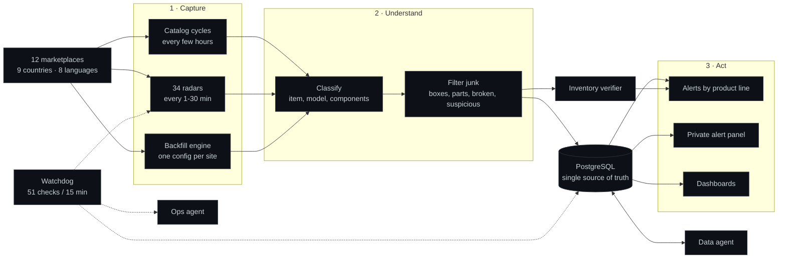
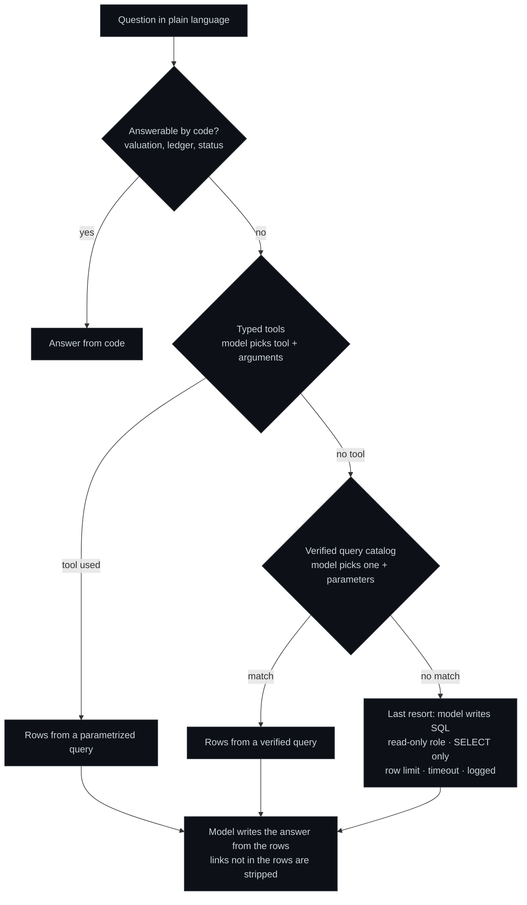
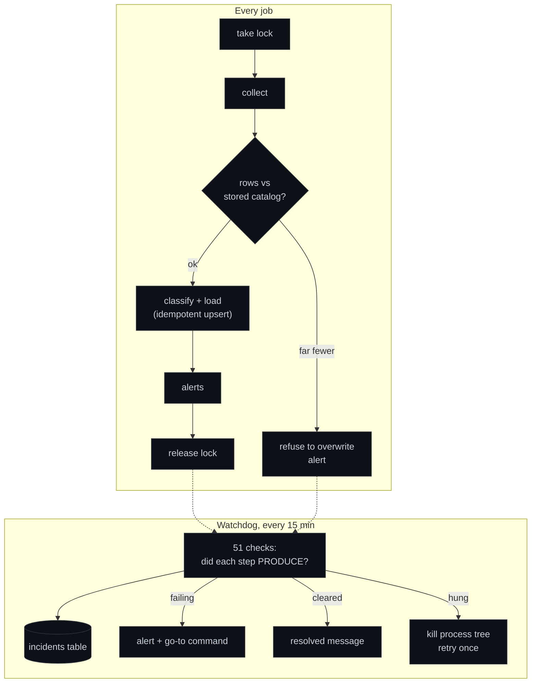
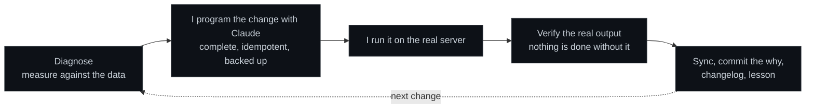

# Market Intelligence Agent

**A 24/7 market-intelligence system I designed, built and run on one home server. It watches 12
second-hand marketplaces in 9 European countries, has captured 700K+ listings, re-scans its
focus categories every 1 to 30 minutes, and uses local AI agents to answer questions, verify
listings and help operate itself, with no data sent to cloud AI services.**

I work in sales. I built this for my own resale operation, where the bottleneck is sourcing: in
this niche the best listings are gone within minutes. The system reads the market for me, decides
what deserves attention and puts it on my phone. Once it is fully hardened, I will also adapt it
for my family's business, where I bring in technology to save time and staff.

> **What this repo is.** A public, sanitized view of a private production system: how it is
> designed, where the AI agents fit and how I run it. The code in `src/` is a runnable demo on
> fictional data. Scoring rules, valuation figures, thresholds, source names, collection
> techniques and the product models that carry margin stay private.

## At a glance

Snapshot of 24 October 2026. Live figures, refreshed every morning from production, are on
[miguelmoralesgarcia.es](https://miguelmoralesgarcia.es/sourcing-system).

| | |
|---|---|
| **Coverage** | 12 marketplaces in 9 countries: Spain, France, Italy, Germany, the Netherlands, Belgium, Poland, Portugal and Austria |
| **Languages** | 8, each with its own classification dictionary |
| **Data** | 709K listings captured, about 5K new every day, 94% classified automatically, 342K filtered out as junk or off-target |
| **Sales signal** | 11.4K listings followed until they sold |
| **Radars** | 34, re-scanning every 1 to 30 minutes on an adaptive pace that brakes at the first block; about 200 alerts a day |
| **Automation** | 65+ scheduled jobs and 7 always-on services on one Windows server |
| **Monitoring** | 51 checks every 15 minutes that test output, not just liveness |
| **History** | 513 commits since 11 July 2026, each one explaining why |
| **AI** | Local only: Ollama with Qwen 2.5 14B on a 24 GB GPU |

## How it works



### 1. Capture, at two speeds

**Catalog cycles** crawl each category every few hours and keep the price database complete:
PC components, complete PCs, laptops, servers, bikes and machinery. They are incremental: a run
processes only new listings and stops when it meets a streak of ones it already knows.

**Radars** watch the focus categories (high-end graphics cards, server hardware and complete PCs
built around a high-end card) so a good listing reaches my phone minutes after it goes live. Their
pace is not fixed: a radar speeds up after clean passes, brakes on the first sign that a site is
pushing back, and stops itself rather than insist.

**A backfill engine** makes a new marketplace a configuration file (language, search terms, how
to read a results page) instead of a new program. Every source goes through the same guards.

### 2. Understand each listing

Titles are noisy, multilingual and often misleading. The classifier decides what is really for
sale: a whole PC, a single part, an empty box, a cooler sold alone, a laptop described as a
desktop. It extracts the model and, for complete PCs and servers, the components. Memory modules
get a full spec read, and servers get their memory generation from the model generation. When
the title is not enough, the radar also reads the description.

- **One dictionary block per language.** Each block records whether it was validated against a
  sample of real listings or only translated, and the two are never confused.
- **The classifier is the only place classification rules live.** If a rule is wrong I fix the
  classifier and let the next load rewrite the table. A fix made only in the database would be
  overwritten by the next run.

### 3. Act on it

- Alerts go to a separate channel per product line, with what the system detected (model,
  components, spec) so I can decide from the alert alone.
- The same item relisted under a new id does not alert twice: the radars share a memory by content.
  A price drop on a listing already seen arrives as a drop, with the previous price.
- **Labels, not filters.** A price far below normal is flagged *verify in person*, never hidden.
  Cheap is not the same as fake, and a filter that removes scams also removes the best deals.
- A complete-PC alert carries a teardown line: what its parts are worth, computed by code.
- Every alert is stored. A private, read-only panel lets me search and filter the alert history
  from my phone over a private network.

## The AI agents

All models run locally. The rule that took me longest to learn: **code detects and calculates;
the model translates between people and code.** Every time a model was asked to judge, or to
produce a figure, false data appeared.

| Agent | What it does | What it is never allowed to do |
|---|---|---|
| **Data agent** (Telegram) | Answers business questions in plain language over the whole database | Invent figures or links; write to the database |
| **Inventory verifier** | Reads a complete-PC listing and lists what is in the box: parts present, missing or broken | Decide whether it is a deal. The code values the parts |
| **Listing verifier** | Decides what is actually being sold before a bike deal is reported | Guess from keywords |
| **Ops agent** (Telegram) | Reports health and hardware sensors, and runs a short list of maintenance actions on request | Run anything outside a closed list, or act without my confirmation |

**The data agent is a cascade ordered by trust.** I built the three classic patterns (a fixed
query catalog, typed tool calling and model-written SQL) and kept all three, in that order of
preference. Code answers everything it can; the model writes SQL only as the last resort, inside a
read-only role, with a SELECT-only validator, a forced row limit and a statement timeout. Every
question that reaches that tier is logged, so the verified catalog grows from real use. The demo
in `src/` implements the typed-tools tier.



**The inventory verifier asks what is in the box.** Ask a model whether a listing is a good deal
and it says yes. So the verifier never judges: it lists components, what is missing and what is
broken, and the code does the valuation. There are three outcomes: worth it as a teardown (alert
with the breakdown), not worth it (silence), or very cheap with no visible reason (a separate
*verify in person* alert). A missing graphics card is not a reason to discard a PC; it is
information to value it again.

**The ops agent can diagnose freely and act narrowly.** Every action needs my confirmation within
60 seconds, and the name that gets executed comes from the system's own list of services and
jobs, never from the text of the message.

**Where I took the model out.** Watchdog alerts used to be paraphrased by the model; it repeated
them and once advised re-running a collector whose IP was blocked. Alerts now go out exactly as
the check wrote them. The daily summary and the business snapshot are computed by code, so numbers
never pass through the model.

More detail in [docs/agents.md](docs/agents.md).

## Running it unattended



- **Output, not liveness.** A process being alive tells me nothing. The checks ask whether each
  marketplace and category is still adding rows, whether every radar completes passes, whether
  each backfill reaches the database, whether the sold-detection sensors still fire and whether
  the junk filter still catches something. Each check reads the real log format of what it
  watches, and is tested against old broken logs: zero alerts only proves there are no false
  positives.
- **Every alert is actionable.** It carries a *go to* line with the command to run and how to
  read its output, resolves itself when the condition clears, and is written to an incidents table.
- **Self-healing.** Hung collectors are killed with their whole process tree, a cycle that fails
  on a site block gets one automatic retry later, stale locks are cleared, and radars brake
  themselves. A job switched off without a declared pause raises an alert. The watchdog and the
  sales verifier watch each other through a heartbeat, so neither can die silently.
- **Data safety.** A file that accumulates a catalog refuses to be overwritten by a run that
  returns far less than it holds. Radar state is written atomically. The database is dumped every night to two
  physical disks, a restore is tested automatically every week, and the largest catalog restores
  itself from the last validated backup if it is ever corrupted. Secrets live outside the code.
- **Recovery.** After a power cut the server brings the whole system back in order, with nobody
  logged in.
- **A declared ecosystem.** One declaration file lists every vertical, job and service. A validator
  compares it with what is really installed and must report *all consistent* before any commit,
  and the system inventory is generated from the machine itself, never written by hand.

More detail in [docs/architecture.md](docs/architecture.md).

## How I build it

I am not a software engineer by training. I orchestrate the whole system, from the architecture
and the product rules to every risk decision and its day-to-day operation, and I program it with
AI, specifically Claude, under a protocol I set and enforce:



- Diagnose before touching, and measure the impact against the database before adding any rule.
- Every change is a complete script: backup first, a named marker so it cannot apply twice, and
  exact anchors that abort unless they match once.
- I run it on the real server and paste back the real output. Nothing counts as done until the
  output shows it.
- One change open at a time. Each one ends with a repo sync, a commit that explains why and a row
  in the changelog. Wrong hypotheses are written down, so each mistake is paid for once.

The domain rules come from me. Some of the most valuable ones started as me correcting the AI's
design: never hide a deal for being cheap, and treat a missing part as a reason to value a listing
again, not to discard it.

## What this shows

- **Systems design.** From one scraper to a declared platform where a new country is a
  configuration file and a dictionary.
- **Data engineering.** PostgreSQL as the single source of truth, idempotent upserts,
  classifier-first fixes and guards on every dataset that accumulates.
- **Applied AI.** Local models with tool calling, prompts tested against real listings, and knowing
  when to take the model out.
- **Reliability.** Monitoring that checks output, self-healing, a runbook in every alert, restores
  that are actually tested.
- **Product judgment.** Precision over volume, labels over filters, measure before building.
- **AI-assisted engineering.** Orchestrating, programming and running production software with
  Claude under a verification protocol, without a software engineering background.

## Lessons that cost something

- An empty run once overwrote a 142,632-listing catalog, with exit code 0 and clean locks. Every
  file that accumulates now has an anti-wipe guard.
- A broken regex does not fail; it just never matches. Only real data catches it.
- A function copied into five files is a fix waiting to be half done. Four copies were patched,
  and a daily digest stayed at zero for three days.
- One keyword rule would have mislabeled 1,028 bikes. Measuring first stopped it.
- In an if/return cascade, the order is the logic.
- A scheduler's "success" means the process ended, not that it did its job.
- Asking "is this a part?" made the model see parts everywhere and discard complete bikes. Asking
  "what is being sold?" fixed it.
- If the data is wrong, no layer above it can fix it: data first, messenger second.

## Tech stack

Node.js, PowerShell, PostgreSQL 18, Playwright with headless Chrome, Ollama with Qwen 2.5 14B,
Metabase, n8n, Telegram Bot API, Windows services and Task Scheduler, Tailscale, Git. One server:
16-core CPU, 128 GB RAM, 24 GB GPU.

## Running the demo

The code in `src/` runs against fictional in-memory data. The agent needs a local
[Ollama](https://ollama.com) with a model that supports tool calling.

```bash
npm run check                      # syntax-check all modules
node src/monitoring/watchdog.js    # run the health checks against sample input
node examples/ask.js "what's the RTX 4070 going for?"
node examples/ask.js "compare the RTX 4070 and the 4070 Ti"
```

Without Ollama, [examples/expected_output.md](examples/expected_output.md) shows what a run
looks like.

## Repository layout

```
src/agent/       tool-calling loop and whitelist validation (the typed-tools tier)
src/tools/       typed tool definitions the model can call
src/db/          schema, example read queries, data-access layer
src/monitoring/  watchdog and health checks
examples/        runnable examples
docs/            architecture and agents notes
```

## What's next

- **Adapt it for the family business,** where I bring in technology to save time and staff: the
  same platform, pointed at its sourcing, once it has proven here that it runs unattended. That is
  why so much of the recent work is about robustness rather than new features.
- **Value a PC part by part.** Finish the component classes still missing (motherboard, storage,
  power supply) so every complete PC gets a full teardown valuation, then calibrate it against
  observed sales.
- **Vision.** Read the part numbers on photos of memory modules with a local vision model on a
  second GPU.
- **New countries only after measuring them.** Volume and prices are sampled by hand first; the
  collector comes second.

## Scope

This repo shows the architecture and the patterns. The scoring formulas, price thresholds, data
sources, collection techniques and the product models that carry margin are private. I am happy
to walk through the reasoning behind any of it in a conversation.

## License

MIT. See [LICENSE](LICENSE).
