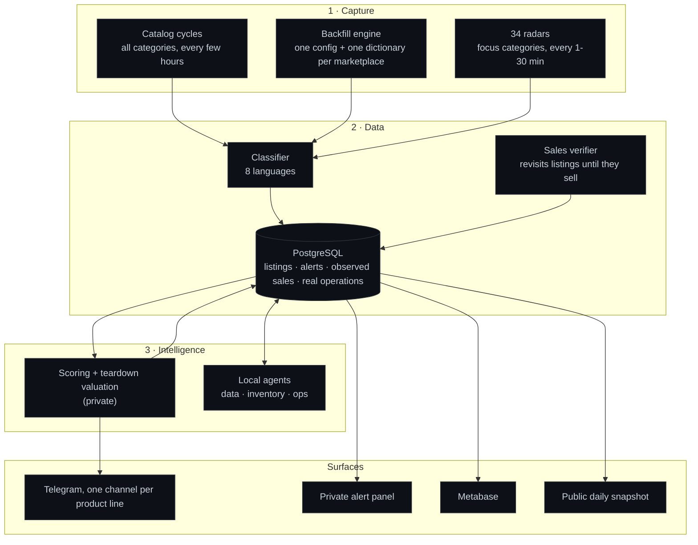
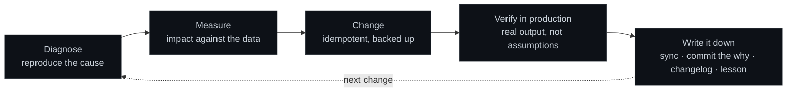

# Architecture

One Windows server runs everything: the collectors, PostgreSQL, the local models, the dashboards
and the bots. 65+ scheduled jobs and 7 always-on services, declared in one file and watched by
one watchdog.

## Capture

**Catalog cycles** keep the price database complete for every category: PC components, complete
PCs, laptops, servers, bikes and machinery. Each one keeps the ids it has already seen, processes
only new listings and stops early when it meets a streak of known ones. Cycles that hit the same
site never overlap; cycles for different sites run in parallel.

**Radars** watch the focus categories in every marketplace, each one as an independent job with
its own lock, so a slow or blocked site never holds back the others. Their pace adapts: a radar
climbs to a faster interval after a run of clean passes, drops back at the first sign of
resistance, and switches itself off when a site blocks it. A radar never tries to push through a
block, because the server's network identity is the scarce resource, not CPU or memory.

**The backfill engine** brings a marketplace's catalog into the database. Everything specific to
a site is in its configuration (language, search terms, how to read a results page); the engine,
the classifier and the guards are shared. Opening a new country is a configuration and a
dictionary, plus a manual market sample before any of it is built.

## Data

PostgreSQL is the only source of truth. A loader classifies each listing (item type, model,
components, memory spec), attaches the system's estimate and upserts it. Upserts never downgrade
a known state: once a listing is marked sold, a later capture cannot flip it back.

- **Classifier first.** The classifier is the only place classification rules live. A wrong rule
  is fixed there and the next load rewrites the table; a fix made only in the database would be
  overwritten.
- **Languages are data, not code.** Each language is a self-contained dictionary block. Each block
  records whether it was validated against a sample of real listings or only translated.
- **Observed sales.** A verifier revisits published listings and records which ones sold and how
  long they took, so asking prices can be compared with what actually sells.
- **Alerts are data.** Every radar alert is written to its own table with the detected model and
  spec, through a queue with a checkpoint, so a database outage delays the load instead of losing
  alerts.
- **Real operations.** A ledger for real purchases and sales, including teardowns where one
  purchase becomes several sales, is written by fixed, parametrized SQL only.

## Intelligence

The private scoring step values each listing against observed market references and decides what
is worth an alert. For complete PCs it adds a teardown valuation: what the parts are worth
separately. The agents sit on top; see [agents.md](agents.md).

## Operations

**Watchdog.** 51 checks every 15 minutes. Each one checks that its component *produced*
something: fresh rows per marketplace and category, completed radar passes, backfills that reach
the database, sold-detection sensors that still fire, a junk filter that still catches junk,
valid backups. Each check knows the real log format of what it watches, and each one was tested
against old broken logs as well as against a healthy system.

**Alerts with a runbook.** Every alert carries a *go to* line with the command to run and how to
read the output. When a condition clears the watchdog sends a resolved message. Every incident is
written to a table, so failures can be charted and queried.

**Self-healing.**

- Collectors hung for too long are killed together with their whole process tree.
- A cycle that fails on a site block gets one automatic retry, later, from the watchdog.
- Locks left by dead processes are cleared.
- Radars brake and recover by themselves.
- A job that is switched off without a declared pause raises an alert; a declared pause is shown
  apart and never undone by a restart.
- The watchdog and the sales verifier watch each other through a heartbeat.

**Data safety.**

- Every file that accumulates a catalog refuses a run that returns far less than it holds. This
  guard exists because an empty run once overwrote a 142,632-listing catalog with exit code 0.
- Radar state files are written atomically: write a temporary file, then rename.
- The database is dumped every night to two physical disks, and a restore is tested
  automatically every week.
- The largest catalog restores itself from the last validated backup if it is ever corrupted.
  Backups validate what they copy, so they never preserve a file that is already broken.
- Secrets live outside the code and outside the repository.

**Recovery.** After a power cut, a boot-time job brings the whole system back in order with nobody
logged in. A controlled shutdown stops everything in order and kills what hangs after a timeout.

## The declared ecosystem

One declaration file is the source of truth for what should exist: verticals, cycles, radars,
services, data files and their guards, log patterns and production thresholds, declared pauses.

- A validator compares the declaration with what is installed (jobs, services, guards, checks) and
  must report *all consistent* before any commit.
- The inventory of the system is generated from the machine itself and regenerated on every sync.
  It is never edited by hand.
- Adding a vertical or a marketplace follows a fixed order: declare it, create its job, add the
  anti-wipe guard if it accumulates, add its production check with the real log pattern, test the
  check against broken history, validate.

## How I work

- Diagnose before touching. Reproduce the cause first.
- Measure before adding a rule. One keyword would have mislabeled 1,028 bikes.
- Deliver, execute, verify. A change without observed output is not done.
- Check for duplicated functions before patching: patch every live copy or none.
- One change open at a time, and write down every wrong hypothesis so it is paid for once.
